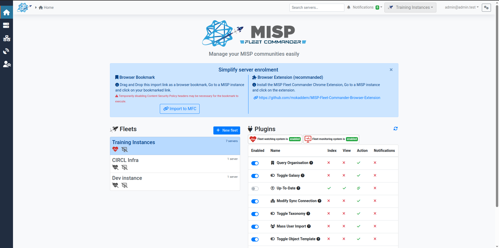
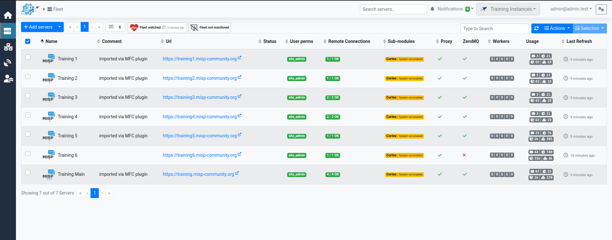
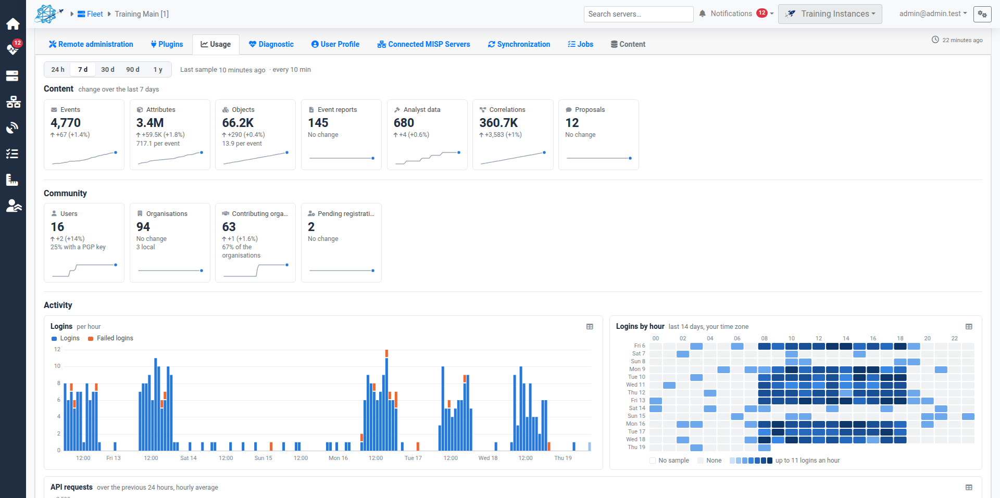

# MISP Fleet Commander


**Manage your MISP communities with ease.**

## 🛰️ What is MISP Fleet Commander?

**MISP Fleet Commander** is a flexible tool designed to manage fleets of [MISP](https://www.misp-project.org/) servers. Whether you're administering a couple of instances or an entire constellation, this application gives you the visibility and control you need — all from a single interface.

With MISP Fleet Commander, you can diagnose, configure, update, and monitor MISP servers at scale. It’s built for those who need to keep multiple MISP servers in sync and in check.


## ✨ Features

- **Create and organize fleets** of MISP servers.
- **Monitor server health** and collect real-time metrics.
- **Perform batch API operations** across servers.
- **Drag-and-drop plugin support**, integrated directly into the UI.
- **Visualize sync links and topologies** with the *Strategic View*.
- **Quickly enroll new servers** via a browser extension.
- **Built-in usage monitoring**: metric history and charts for every server, with no extra service to run, and a Prometheus endpoint for existing setups.
- Designed for **flexibility** and ease of use.

## 💡 Why This Project?

> Back in 2020, I was managing multiple MISP servers and found myself constantly repeating tasks — monitoring health, tweaking configs, running the same API calls across instances. I also wanted to explore some modern web technologies I wasn’t familiar with. So, I started building MISP Fleet Commander in my spare time — mostly just for fun.
>
> Now, in 2025 — five years later — it’s finally stable enough to share with the world.

This is a project built out of real-world need, shaped by curiosity and the desire to experiment and have fun. If you’ve ever had to wrangle a fleet of MISP servers, this tool is for you.


## 🚀 Getting Started

### 📦 Requirements

- python 3.11
- A modern browser (for using the UI and extensions)

### 🛠️ Installation

Clone the repository:

```bash
git clone --recursive https://github.com/mokaddem/MISP-Fleet-Commander.git
cd MISP-Fleet-Commander
```

`--recursive` also fetches [MispQL](https://github.com/MISP/MispQL) into `backend/vendor/mispql`. In a clone made without it: `git submodule update --init`.

Install dependencies:

```bash
pushd backend
bash install.sh
popd
```

### ▶️ Running the Application
Start the server:

```bash
bash start.sh
```

This will start a local server running on all addresses (0.0.0.0) (typically at http://localhost:5001) where you can interact with the UI.


#### Or you can use Docker

```bash
docker compose up -d --build
```

The UI is then available on port 5001 of the host (e.g. http://localhost:5001). The database, the generated secret and encryption keys, the instance settings and the cached images are kept in `./run`.

To update: `git pull && git submodule update --init && docker compose up -d --build`.

A default admin user is already provisioned with the following credential:
```text
admin@admin.test:Password1234
```
You are asked to choose a new password on the first login: until then, the account cannot do anything else.

The secret signing the session tokens is generated on the first start (`backend/database/secret_key`, or `./run/secret_key` with Docker). Set `SECRET_KEY` to provide your own.

### 🔀 Behind a reverse proxy

Set `TRUSTED_PROXIES` to the number of reverse proxies in front of the application (usually `1`). The client address, protocol and host are then read from the `X-Forwarded-For`, `X-Forwarded-Proto`, `X-Forwarded-Host` and `X-Forwarded-Port` headers those proxies set. Without it, every request seems to come from the proxy: failed logins are counted per address and account, so anyone could lock any account out for 15 minutes.

Leave it at `0` (the default) when clients connect directly: the application would otherwise believe the address a client claims in `X-Forwarded-For`.

### 🔄 Updating

To update the application:
```bash
bash update.sh
```

It pulls the code, fetches MispQL, installs the Python dependencies, migrates the database and builds the web app again (which needs Node.js and npm, as `build_web.sh` does). Then restart the web server and the workers (the `flask` and `workers` windows of the `screen` session) so that they run the new code.

> [!WARNING]
> **Upgrading from a version that stored keys in clear.** The update encrypts the MISP authkeys of your servers and hashes the users' API keys in the database (see [Encryption key](#-encryption-key)). Copies of the database taken before the update are not changed: backups, snapshots and copies of the database file (`backend/database/database.db`, or `./run/database.db` with Docker) still hold those keys in clear. Delete them, or keep them as carefully as the keys themselves. If such a copy may have been exposed, rotate the authkeys on the MISP instances and generate new API keys for the users.

### 🔐 Encryption key

The MISP authkeys of your servers are encrypted in the database. The key is read from the `MFC_ENCRYPTION_KEY` environment variable or, when it is not set, from a key file that is generated on the first start: `backend/database/encryption_key`, or `./run/encryption_key` with Docker. Set `MFC_ENCRYPTION_KEY_FILE` to keep the file elsewhere.

**Back this key up**, separately from the database: the stored authkeys cannot be read without it. The application refuses to start when the key is missing or does not match the database.

To rotate the key:
1. Generate a new key with `flask security generate-key` (Docker: `docker compose exec backend flask security generate-key`).
2. Configure the new key first, followed by the current one: `MFC_ENCRYPTION_KEY="NEW_KEY,CURRENT_KEY"`, or one key per line in the key file.
3. Restart, then run `flask security rotate-key` to re-encrypt the authkeys with the new key.
4. Remove the old key and restart.

## Development
### ▶️ Running the Application (Development Mode)
Start the development server:

```bash
bash start_dev.sh
```

This will start a local development server (typically at http://localhost:5001/) and a local web development server (typically at http://localhost:8080/).

### 🧪 Tests
The backend tests need neither Redis nor a MISP instance:

```bash
cd backend
pip install -r requirements.txt -r requirements-dev.txt
pip install --no-deps vendor/mispql
python -m pytest
```

The web UI's helpers and store modules have unit tests (Vitest, in `web/tests/unit/`), and the UI is linted:

```bash
cd web
npm run test:unit
npx vue-cli-service lint --no-fix
```

CI runs all of them, plus the migrations on an empty database.

### 📌 Dependencies
The backend's direct dependencies are listed in `backend/requirements*.in`; the `requirements*.txt` files pin the whole set. After changing a `.in` file, regenerate the pins (from `backend/`, with `requirements-dev.txt` installed):

```bash
pip-compile requirements.in && pip-compile requirements-dev.in
```

[MispQL](https://github.com/MISP/MispQL) is a git submodule at `backend/vendor/mispql`, pinned to a commit and installed with `pip install --no-deps vendor/mispql`: Fleet Commander only uses its compiler and reply readers, which need nothing beyond the standard library, so it stays out of the `.in` files. To move it, check out another commit in `backend/vendor/mispql` and commit the new pointer.


### 🏗️ Building for Production
To create an optimized production build:

```bash
bash build_web.sh
```

This will build the web application and make the file available for the backend.


## 🌍 Browser Extension
Enrolling new MISP servers can be a pain: You have to generate an API key, and manually enter all the information in MFC. [The MISP Fleet Commander Browser Extension](https://github.com/mokaddem/MISP-Fleet-Commander-Browser-Extension) (chrome only) allows you to enroll the MISP server you're currently browsing in one click.

It works from other origins than the one serving the UI, so the API endpoints it uses (`/fleets/index`, `/servers/add`, `/users/view/me`) accept cross-origin requests. The rest of the API only accepts requests from the UI's origin: list any other origin that must call it in `CORS_ALLOWED_ORIGINS` (comma separated).

## 📷 Screenshots

<table>
    <tr>
        <td>
            Home page
            
        </td>
        <td>
            The fleet index showing all servers from the selected fleet
            </td>
    </tr> 
    <tr>
        <td>
            Server view
            </td>
        <td>
            Plugin page showing all available plugins
            
        </td>
    </tr>
    <tr>
        <td>
            Batch API modal allowing to run API call on multiple server at once
            
        </td>
        <td>
            Strategic View page displaying how inter-connected are servers in the selected fleet
            
        </td>
    </tr>
    <tr>
        <td>
            Connection page listing all known server synchronisation and their status
            
        </td>
        <td>
            Usage tab of a server, drawn from the metrics MISP Fleet Commander collects
            
        </td>
    </tr>
</table>

## 📈 Monitoring
MISP Fleet Commander keeps a history of the usage of the servers in monitored fleets, in its own database. There is nothing else to install or configure.

What is collected, every 10 minutes by default:
- **Content**: events, attributes, objects, event reports, analyst data, correlations and proposals.
- **Community**: users (and how many have a PGP key), organisations, contributing organisations and pending registrations.
- **Activity**: logins and failed logins, counted from the MISP logs, and API requests over the last 24 hours. What MISP Fleet Commander does itself is left out: the API requests of the account its API key belongs to, and that account's logins (failed attempts on it still count). No email, organisation or IP address is stored.
- **System**: load, memory and disk usage, and the size of MISP's database.
- **MISP internals**: Redis memory and the jobs waiting in each worker queue.

To monitor a fleet, edit it and tick **Monitor**.

Monitoring is on by default. It can be turned off for every fleet with `Monitoring Enabled`, in the `Scheduler` tab of the settings (button in the top right corner), where `Monitoring Interval` sets how often the servers are queried, in minutes. Existing installs keep their current value: check that it is enabled after upgrading.

The first samples arrive within a minute or two. The first collection of a server also counts its logins of the last 90 days (fewer when the logs are very busy), so the login charts don't start empty. Each server's page then shows its charts in the `Usage` tab, from the last 24 hours to the last year, along with the most expensive endpoints of the day. The fleet page has a `Usage` tab too: the fleet's totals over time (logins, API requests, content, database size, queued jobs) and its servers side by side, with the figures that don't add up across servers (load, memory, disk). Content synchronised between servers counts once on each server that holds it.

Use a site admin API key: with another key, MISP refuses some of these figures and only lists the logins of the key's own organisation.

By default, every sample is kept for 14 days, hourly figures for 90 days and daily figures for as long as the server exists. With 50 servers, that is roughly 190 MB, plus 20 MB per year. The three periods are settings in the same tab (`Sample Retention`, `Hourly Retention`, `Daily Retention`, in days). Each day kept costs about 110 kB per server for samples (at a 10-minute interval), 26 kB for hourly figures and 1 kB for daily ones. A shorter period applies at the next hourly roll-up.

`flask server monitor-fleets` (Docker: `docker compose exec backend flask server monitor-fleets`) runs one collection right away and prints the outcome for each server.

> [!NOTE]
> **Upgrading from the InfluxDB and Grafana integration.** MISP Fleet Commander no longer writes to InfluxDB or renders Grafana panels: the InfluxDB, Grafana and image renderer containers can be shut down, and the `INFLUXDB_*` and `GRAFANA_*` variables removed. Their data isn't imported, so the new charts start from the first collection. Admins who want to keep a Grafana dashboard can scrape the metrics with Prometheus (below).

### Scraping the metrics with Prometheus
The usage metrics collected from the servers of monitored fleets are also served in the Prometheus text format at `GET /metrics`. A scrape only reads what MISP Fleet Commander stored: it never queries MISP. Each user sees their own servers.

Authenticate with an MISP Fleet Commander API key, sent as `Authorization: Apikey <key>`:
```yaml
scrape_configs:
  - job_name: misp-fleet-commander
    scrape_interval: 1m
    metrics_path: /metrics
    # scheme: https  # When MISP Fleet Commander is behind TLS
    authorization:
      type: Apikey
      credentials: <MISP Fleet Commander API key>
    static_configs:
      - targets: ['mfc.example:5001']
```

Every series has the `server`, `server_id` and `fleet` labels.
- One gauge per collected metric, from the latest sample: `misp_events`, `misp_attributes`, `misp_users`, `misp_load_1`, `misp_memory_used_ratio`, `misp_db_size_bytes`, `misp_queue_jobs{queue="default"}`, … A metric that could not be read at the last collection is left out.
- `misp_logins_total` and `misp_failed_logins_total`: counters of the logins seen in the MISP logs.
- `misp_up`: 1 when the last collection read something. `misp_last_sample_timestamp_seconds`: when the latest sample was taken. `misp_info{version="…"}`: the MISP version.
- `mfc_monitoring_enabled`: 0 when monitoring is disabled in the settings. Servers then have no series.
- Saved queries that run on a schedule add the labels `saved_query`, `saved_query_id` and `kind` (`count` or `select`), per server they run on: `mfc_saved_query_value` is the last number the server answered (a count, or the rows a SELECT returned, at most its LIMIT), `mfc_saved_query_expectation_met` is 1 or 0 when the saved query expects something, `mfc_saved_query_up` is 0 when the last run gave no number there (no complex queries, query errors, timeout…), and `mfc_saved_query_last_run_timestamp_seconds` says when it answered. Statements are never exposed. `mfc_saved_query_schedule_enabled` is 0 when scheduled runs are off in the settings (`Queries` tab); saved queries then have no series.

For example, `time() - misp_last_sample_timestamp_seconds > 3600` catches a server that hasn't been collected for an hour, and `mfc_saved_query_expectation_met == 0` a server whose answer to a saved query is not as expected.

## 📬 Feedback & Contributions

Contributions, bug reports, and feature suggestions are **more than welcome**!
- Fork the project
- Create a new branch (git checkout -b feature/your-feature)
- Commit your changes
- Open a pull request
- Or simply open an issue

### 🧩 How to Add a New Plugin
MISP Fleet Commander supports a plugin system to extend its UI and functionality. Adding a new plugin is quick and doesn't require a full rebuild of the application.

#### 🔧 Steps to Create a Plugin

1. Go in `backend/application/plugins`.
2. Copy/Paste a plugin and modify it to your needs 😉.

## 🤝 Acknowledgments

Special thanks to the MISP Project and its community for building such a foundational tool for threat intelligence sharing.


## ©️ Copyright
```
© 2021–2025 Sami Mokaddem.
© Logo designed by Ysaline Rochez — thank you for the beautiful work!
```
