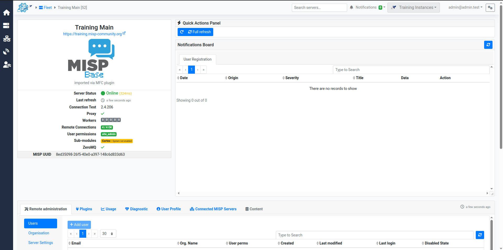
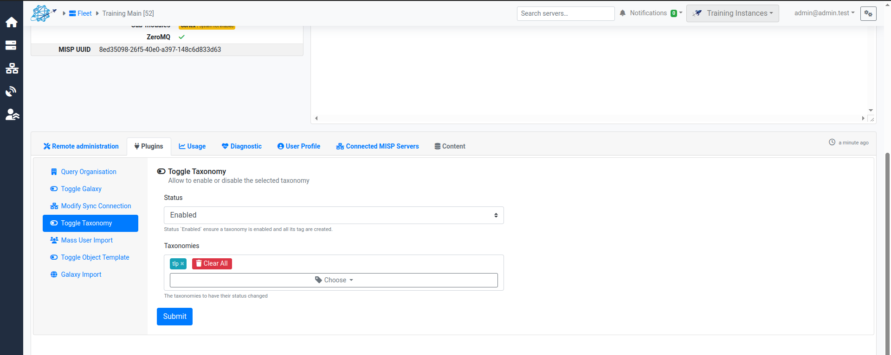
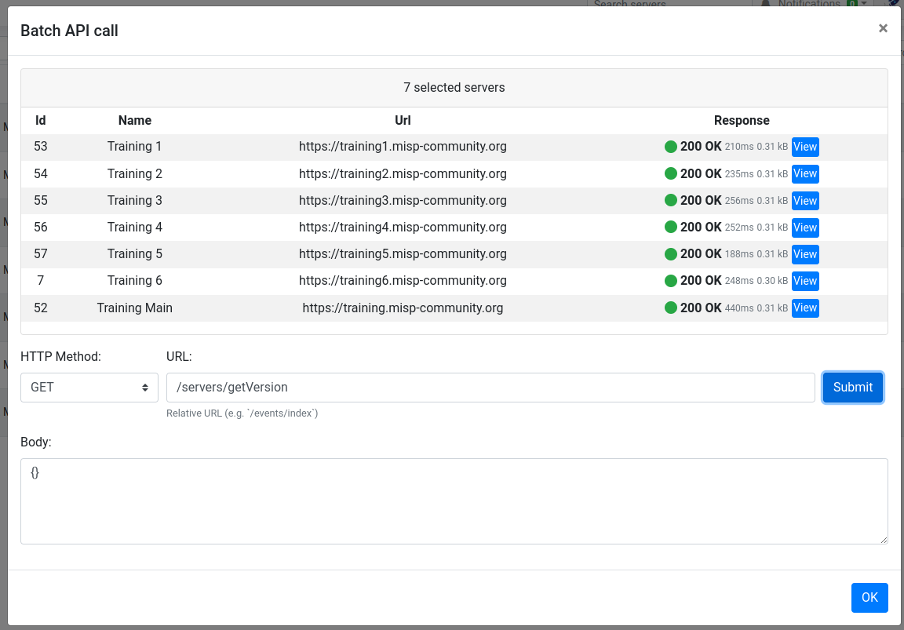
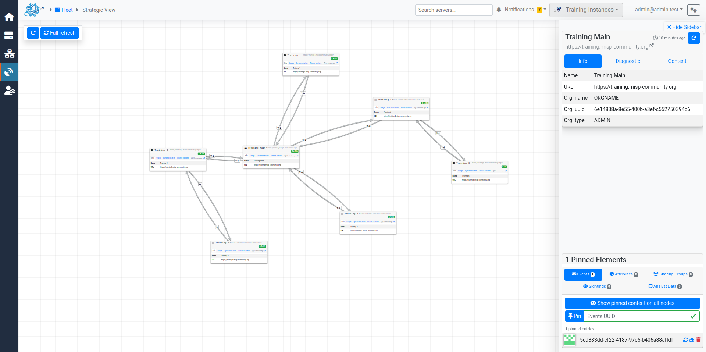
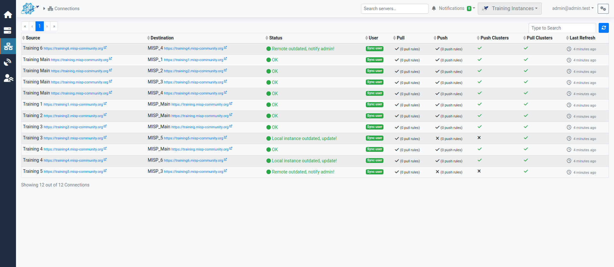
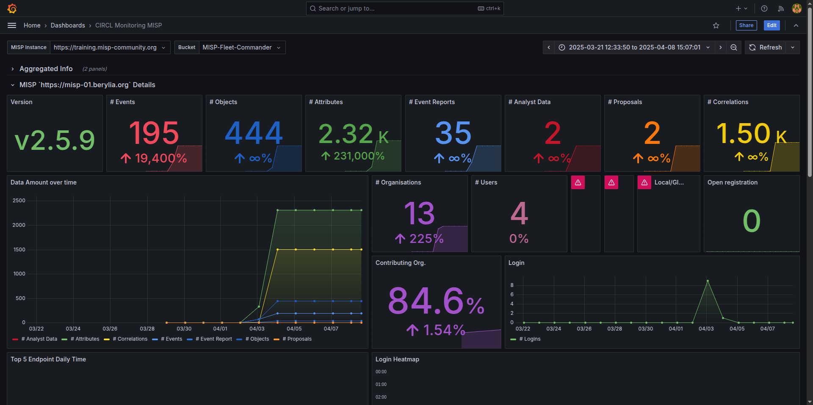

# MISP Fleet Commander


**Manage your MISP communities with ease.**

## 🛰️ What is MISP Fleet Commander?

**MISP Fleet Commander** is a flexible tool designed to manage fleets of [MISP](https://www.misp-project.org/) servers. Whether you're administering a couple of instances or an entire constellation, this application gives you the visibility and control you need — all from a single interface.

With MISP Fleet Commander, you can diagnose, configure, update, and monitor MISP servers at scale. It’s built for those who need to keep multiple MISP servers in sync and in check.


## ✨ Features

- **Create and organize fleets** of MISP servers.
- **Monitor server health** and collect real-time metrics.
- **Perform batch API operations** across servers.
- **Drag-and-drop plugin support**, integrated directly into the UI.
- **Visualize sync links and topologies** with the *Strategic View*.
- **Quickly enroll new servers** via a browser bookmarklet or extension.
- **Built-in integration with Grafana and InfluxDB** for metrics storage and visualization
- Designed for **flexibility** and ease of use.

## 💡 Why This Project?

> Back in 2020, I was managing multiple MISP servers and found myself constantly repeating tasks — monitoring health, tweaking configs, running the same API calls across instances. I also wanted to explore some modern web technologies I wasn’t familiar with. So, I started building MISP Fleet Commander in my spare time — mostly just for fun.
>
> Now, in 2025 — five years later — it’s finally stable enough to share with the world.

This is a project built out of real-world need, shaped by curiosity and the desire to experiment and have fun. If you’ve ever had to wrangle a fleet of MISP servers, this tool is for you.


## 🚀 Getting Started

### 📦 Requirements

- python 3.11
- A modern browser (for using the UI and extensions)

### 🛠️ Installation

Clone the repository:

```bash
git clone https://github.com/mokaddem/MISP-Fleet-Commander.git
cd MISP-Fleet-Commander
```

Install dependencies:

```bash
pushd backend
bash install.sh
popd
```

### ▶️ Running the Application
Start the server:

```bash
bash start.sh
```

This will start a local server running on all addresses (0.0.0.0) (typically at http://localhost:5001) where you can interact with the UI.


#### Or you can use Docker

```bash
docker compose up -d --build
```

The UI is then available on port 5001 of the host (e.g. http://localhost:5001). The database, the generated secret and encryption keys, the instance settings and the cached images are kept in `./run`.

To update: `git pull && docker compose up -d --build`.

A default admin user is already provisioned with the following credential:
```text
admin@admin.test:Password1234
```
You are asked to choose a new password on the first login: until then, the account cannot do anything else.

The secret signing the session tokens is generated on the first start (`backend/database/secret_key`, or `./run/secret_key` with Docker). Set `SECRET_KEY` to provide your own.

### 🔄 Updating

To update the application:
```bash
bash update.sh
```

### 🔐 Encryption key

The MISP authkeys of your servers are encrypted in the database. The key is read from the `MFC_ENCRYPTION_KEY` environment variable or, when it is not set, from a key file that is generated on the first start: `backend/database/encryption_key`, or `./run/encryption_key` with Docker. Set `MFC_ENCRYPTION_KEY_FILE` to keep the file elsewhere.

**Back this key up**, separately from the database: the stored authkeys cannot be read without it. The application refuses to start when the key is missing or does not match the database.

To rotate the key:
1. Generate a new key with `flask security generate-key` (Docker: `docker compose exec backend flask security generate-key`).
2. Configure the new key first, followed by the current one: `MFC_ENCRYPTION_KEY="NEW_KEY,CURRENT_KEY"`, or one key per line in the key file.
3. Restart, then run `flask security rotate-key` to re-encrypt the authkeys with the new key.
4. Remove the old key and restart.

## Development
### ▶️ Running the Application (Development Mode)
Start the development server:

```bash
bash start_dev.sh
```

This will start a local development server (typically at http://localhost:5001/) and a local web development server (typically at http://localhost:8080/).


### 🏗️ Building for Production
To create an optimized production build:

```bash
bash build_web.sh
```

This will build the web application and make the file available for the backend.


## 🌍 Browser Extension / Bookmarklet
Enrolling new MISP servers can be a pain: You have to generate an API key, and manually enter all the information in MFC. However, there are quicker ways to do it.
- **[recommended]** [The MISP Fleet Commander Browser Extension](https://github.com/mokaddem/MISP-Fleet-Commander-Browser-Extension) (chrome only) allows you to enroll the MISP server you're currently browsing in one click.
- A browser bookmarklet (drag it to your bookmarks bar from the Fleet Commander UI).
  - You'll have to temporarily disable Content Security Policy headers for the bookmark to execute.

Instructions for both are available on the Home page of the app.

Both work from other origins than the one serving the UI, so the API endpoints they use (`/fleets/index`, `/servers/add`, `/users/view/me`) accept cross-origin requests. The rest of the API only accepts requests from the UI's origin: list any other origin that must call it in `CORS_ALLOWED_ORIGINS` (comma separated).

## 📷 Screenshots

<table>
    <tr>
        <td>
            Home page
            
        </td>
        <td>
            The fleet index showing all servers from the selected fleet
            </td>
    </tr> 
    <tr>
        <td>
            Server view
            </td>
        <td>
            Plugin page showing all available plugins
            
        </td>
    </tr>
    <tr>
        <td>
            Batch API modal allowing to run API call on multiple server at once
            
        </td>
        <td>
            Strategic View page displaying how inter-connected are servers in the selected fleet
            
        </td>
    </tr>
    <tr>
        <td>
            Connection page listing all known server synchronisation and their status
            
        </td>
        <td>
            Grafana page displaying all the collected metrics
            
        </td>
    </tr>
</table>

## Setting up metric collection with InfluxDB and Grafana
1. Install the needed dependencies.
```bash
cd backend
. ./venv/bin/activate
pip3 install -U -r requirements_monitoring.txt
```
2. If you already have Grafana and InfluxDB running, go to step 4.
3. Start the InfluxDB and Grafana containers. Set your own passwords and InfluxDB admin token in `.env` first.
```bash
cd backend/application/monitoring/docker
cp .env.sample .env
vim .env  # Replace every change-me value
docker compose up
```
4. Configure MISP Fleet Commander through environment variables, then start (or restart) the server.
   - `INFLUXDB_TOKEN` is required: without it the monitoring system stays disabled.
   - `GRAFANA_APIKEY` is a Grafana service account token, used to render the monitoring graphs. Without it, metrics are still collected but graphs are not rendered.
   - The other variables are optional; their defaults are shown below.
```bash
export INFLUXDB_TOKEN=<token created on InfluxDB>
export INFLUXDB_URL=http://localhost:8086
export INFLUXDB_ORG=org
export INFLUXDB_BUCKET=MISP-Fleet-Commander
export GRAFANA_APIKEY=<grafana service account token>
export GRAFANA_BASE_URL=http://localhost:3000
export GRAFANA_DASHBOARD_DATA_RENDER=render/d-solo/ce6olif96756od
export GRAFANA_DASHBOARD=d/ce6olif96756od/circl-monitoring-misp
bash start.sh
```
   With Docker, put the same variables in a `.env` file next to `docker-compose.yml`; they are passed to the backend and workers.
5. Check that monitoring is supported.
   - Login in MISP Fleet Commander and click on the setting button in the top right corner.
   - If everything went right, you should be able to enable the setting `monitoring_enabled` under the `Scheduler tab`.


## 📬 Feedback & Contributions

Contributions, bug reports, and feature suggestions are **more than welcome**!
- Fork the project
- Create a new branch (git checkout -b feature/your-feature)
- Commit your changes
- Open a pull request
- Or simply open an issue

### 🧩 How to Add a New Plugin
MISP Fleet Commander supports a plugin system to extend its UI and functionality. Adding a new plugin is quick and doesn't require a full rebuild of the application.

#### 🔧 Steps to Create a Plugin

1. Go in `backend/application/plugins`.
2. Copy/Paste a plugin and modify it to your needs 😉.

## 🤝 Acknowledgments

Special thanks to the MISP Project and its community for building such a foundational tool for threat intelligence sharing.


## ©️ Copyright
```
© 2021–2025 Sami Mokaddem.
© Logo designed by Ysaline Rochez — thank you for the beautiful work!
```
